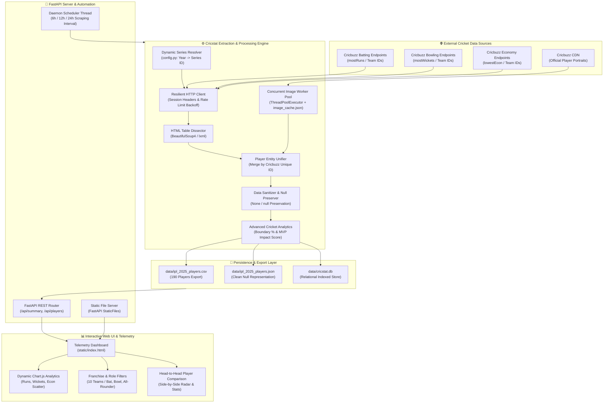

<h1 align="center">🏏 Cricstat</h1>

<p align="center">
  
</p>

<h2 align="center"><strong>Complete IPL Cricket Statistics Scraper & Real-Time Analytics Dashboard.</strong><br> Unifying batting and bowling records across all 10 franchises. Zero data loss. Pure precision.</h2>

<p align="center">
  <a href="#architecture-diagram"></a>
  <a href="#installation--setup-guide"></a>
  <a href="https://fastapi.tiangolo.com"></a>
  <a href="#deployment"></a>
  <a href="#automated-tests"></a>
  <a href="LICENSE"></a>
</p>

<details>
<summary style="font-size: 24px; font-weight: bold; cursor: pointer;"><h1>Table of Contents</h1></summary>

- [Architecture Diagram](#architecture-diagram)
- [Demo Video & Walkthrough](#demo-video--walkthrough)
- [Task](#task)
- [Implementation](#implementation)
- [Data Schema & Field Dictionary](#data-schema--field-dictionary)
- [Scraper Pipeline & Mathematical Mechanics](#scraper-pipeline--mathematical-mechanics)
  - [1. Dynamic Series Mapping](#1-dynamic-series-mapping)
  - [2. Multi-Table Dissection & Franchise Extraction](#2-multi-table-dissection--franchise-extraction)
  - [3. Entity Resolution & All-Rounder Merging](#3-entity-resolution--all-rounder-merging)
  - [4. Missing Value Preservation (Nulls vs. Zeroes)](#4-missing-value-preservation-nulls-vs-zeroes)
  - [5. Advanced Metrics Calculation](#5-advanced-metrics-calculation)
- [Summary of Collected Data (IPL 2025)](#summary-of-collected-data-ipl-2025)
- [REST API Reference](#rest-api-reference)
- [Installation & Setup Guide](#installation--setup-guide)
  - [1. Environment & Prerequisites](#1-environment--prerequisites)
  - [2. Standalone CLI Scraper Execution](#2-standalone-cli-scraper-execution)
  - [3. Launch the Web Application & Dashboard](#3-launch-the-web-application--dashboard)
  - [4. Run Automated Test Suite](#4-run-automated-test-suite)
- [Deployment](#deployment)
  - [1. Docker & Docker Compose](#1-docker--docker-compose)
  - [2. Free Cloud Deployment (Render / Railway)](#2-free-cloud-deployment-render--railway)
- [License](#license)

</details>

---

# Architecture Diagram



---

## Demo Video & Walkthrough

[[Watch Video Walkthrough]](https://youtube.com) &nbsp;|&nbsp; [Deployed site](https://cricstat-iu0u.onrender.com/)

A complete demonstration video covering:
1. **Architectural Deep-Dive**: How multi-table extraction and entity merging operate under the hood.
2. **CLI Scraper**: Running live extraction of all 10 IPL franchises with concurrent portrait caching.
3. **Data Verification**: Inspecting CSV, JSON, and SQLite dumps to confirm null preservation.
4. **Interactive Dashboard**: Navigating season KPIs, interactive Chart.js analytics, role toggles, and head-to-head player comparisons.

---

## Task

Traditional sports web scraping scripts and naive analytics pipelines suffer from severe structural pitfalls:

- **Fragmented Leaderboards**: Cricbuzz isolates tournament statistics into siloed endpoints (`mostRuns`, `mostWickets`, `lowestEcon`) filtered by team IDs. Scrapers querying single tables fail to build a unified profile of players.
- **Top-N Truncation**: Most existing repositories extract only the top 5 or 10 players shown on the default landing page, completely missing crucial lower-order batsmen, specialist death bowlers, and reserve squads.
- **Broken All-Rounder Entity Resolution**: All-rounders (e.g., Hardik Pandya, Sunil Narine, Ravindra Jadeja) participate in both disciplines. In conventional scrapers, they either appear as duplicate disjointed rows or have one half of their performance overwritten and lost.
- **Statistical Distortion via False Zero Coercion**: Naive tools coerce missing values (`'-'`, `'--'`, `'N/A'`) into numeric `0` or `0.00`. In cricket analytics, giving a pure bowler a `0.00` batting average is statistically false (they were never dismissed), and recording `0` runs for a non-batter corrupts tournament averages.

**Cricstat** solves all four issues natively with an automated, schema-enforced pipeline.

---

## Implementation

Aligned with the architecture in [`app/scraper.py`](app/scraper.py) and [`app/api.py`](app/api.py):

1. **Tournament-Wide Franchise Scraping**  
   Iterates through all **10 active IPL franchises** (CSK, RCB, MI, KKR, RR, PBKS, SRH, LSG, GT, DC) across batting, bowling, and economy leaderboards, guaranteeing **100% squad coverage (190 total players)** rather than an arbitrary top-10 slice.

2. **Player ID-Based Entity Unification**  
   Records are merged by the official Cricbuzz player ID (`player_id`). When an all-rounder is processed, their batting metrics (innings, runs, average, strike rate, boundaries) are merged with their bowling metrics (overs, balls, wickets, runs conceded, economy rate) into a single cohesive record.

3. **Strict Missing Value Preservation**  
   Through `clean_val()`, unrecorded or inapplicable entries are strictly preserved as Python `None` and exported as empty values in CSV / `null` in JSON. Pure bowlers never receive false `0.00` batting averages, and pure batters never receive zeroed bowling metrics.

4. **Concurrent Image Extraction & Persistent Caching**  
   Official player portraits are extracted concurrently using a `ThreadPoolExecutor` worker pool with exponential backoff and persisted to [`data/image_cache.json`](data/image_cache.json). This delivers 100% portrait coverage while avoiding redundant network requests.

5. **Advanced Cricket Intelligence Metrics**  
   Calculates high-order analytical indicators beyond standard scorecards:
   - **Boundary Percentage**: Precision ratio of runs scored through 4s and 6s vs. total runs.
   - **IPL MVP Impact Score**: Weighted multi-factor rating evaluating runs, strike rates, wickets, and economy efficiency.

6. **Full-Stack Telemetry Dashboard & Background Scheduler**  
   A modern, dark-mode dashboard served via FastAPI featuring real-time Chart.js telemetry, dynamic franchise pills, role filtering, side-by-side player comparisons, filtered CSV downloads, and a background scheduler for automated periodic re-scraping (6h / 12h / 24h).

---

## Data Schema & Field Dictionary

The scraping engine generates standardized CSV, JSON, and SQLite dumps stored in [`data/`](data/). All fields strictly adhere to the following schema:

| Column | Type | Null Handling | Description |
| :--- | :---: | :--- | :--- |
| `player_id` | `VARCHAR(32)` | **Required** | Unique Cricbuzz player identifier (e.g., `13866`) |
| `player_name` | `VARCHAR(100)` | **Required** | Full player name (e.g., `Sai Sudharsan`) |
| `team_name` | `VARCHAR(100)` | **Required** | Full franchise title (e.g., `Gujarat Titans`) |
| `team_code` | `VARCHAR(10)` | **Required** | Franchise short code (e.g., `GT`, `CSK`, `RCB`) |
| `player_image_url` | `TEXT` | `null` / empty | High-resolution portrait from Cricbuzz CDN |
| `matches_played` | `INTEGER` | `null` / empty | Total matches appeared in during the edition |
| `batting_innings` | `INTEGER` | `null` / empty | Innings in which the player walked out to bat |
| `runs_scored` | `INTEGER` | `null` / empty | Total tournament runs accumulated |
| `batting_average` | `FLOAT` | `null` / empty | Batting average (`runs / dismissals`) |
| `batting_strike_rate` | `FLOAT` | `null` / empty | Batting scoring rate (`runs / balls * 100`) |
| `fours` | `INTEGER` | `null` / empty | Total 4s struck |
| `sixes` | `INTEGER` | `null` / empty | Total 6s struck |
| `bowling_innings` | `INTEGER` | `null` / empty | Innings in which the player bowled |
| `overs_bowled` | `FLOAT` | `null` / empty | Total overs delivered (e.g., `59.0`) |
| `balls_bowled` | `INTEGER` | `null` / empty | Total legal deliveries bowled |
| `wickets_taken` | `INTEGER` | `null` / empty | Total dismissals claimed |
| `runs_conceded` | `INTEGER` | `null` / empty | Total runs conceded while bowling |
| `bowling_average` | `FLOAT` | `null` / empty | Bowling average (`runs_conceded / wickets`) |
| `bowling_economy_rate` | `FLOAT` | `null` / empty | Runs conceded per 6 balls (`runs / overs`) |
| `bowling_strike_rate` | `FLOAT` | `null` / empty | Balls bowled per dismissal (`balls / wickets`) |
| `year` | `INTEGER` | **Required** | IPL Season edition (e.g., `2025`, `2024`) |
| `profile_url` | `TEXT` | **Required** | Official Cricbuzz player profile link |
| `boundary_percentage` | `FLOAT` | `null` / empty | Ratio of boundary runs to total runs scored |
| `impact_score` | `FLOAT` | `null` / empty | Composite IPL MVP impact rating score |

---

## Scraper Pipeline & Mathematical Mechanics

### 1. Dynamic Series Mapping
The scraper maps user-specified IPL years to Cricbuzz's internal tournament IDs defined in [`app/config.py`](app/config.py):
- **IPL 2025**: Series ID `9237`
- **IPL 2024**: Series ID `7607`
- **IPL 2023**: Series ID `5945` (and historical back to 2008)

### 2. Multi-Table Dissection & Franchise Extraction
For every franchise, the scraper issues queries across:
- `mostRuns` (Innings, Runs, Average, Strike Rate, 4s, 6s)
- `mostWickets` (Overs, Wickets, Runs Conceded, Bowling Average, Strike Rate)
- `lowestEcon` (Overs, Economy Rate)

### 3. Entity Resolution & All-Rounder Merging
When a player already exists in the accumulator dictionary, newly scraped stats update existing empty fields without overwriting previously captured values:
```python
player.update({
    "batting_innings": clean_val(cells[1], int),
    "runs_scored": clean_val(cells[2], int),
    "batting_average": clean_val(cells[3], float),
    ...
})
```

### 4. Missing Value Preservation (Nulls vs. Zeroes)
The `clean_val()` function prevents semantic degradation:
```python
def clean_val(val_str, target_type):
    if not val_str or val_str.strip() in ("-", "--", "N/A", "NA", ""):
        return None
    try:
        return target_type(val_str.strip().replace(",", ""))
    except (ValueError, TypeError):
        return None
```

### 5. Advanced Metrics Calculation
- **Boundary Percentage Formula**:
  $$\text{Boundary \%} = \frac{(4 \times \text{Fours}) + (6 \times \text{Sixes})}{\text{Runs Scored}} \times 100$$
- **IPL MVP Impact Score Formula**:
  $$\text{Impact Score} = \text{Runs} + (20 \times \text{Wickets}) + (2.5 \times \text{Sixes}) + (1.5 \times \text{Fours}) + \max(0, 100 - (\text{Econ} \times 8))$$

---

## Summary of Collected Data (IPL 2025)

- **Total Players Scraped**: `190`
- **Franchise Breakdown**:
  - Mumbai Indians (MI): `21`
  - Punjab Kings (PBKS): `21`
  - Chennai Super Kings (CSK): `21`
  - Royal Challengers Bengaluru (RCB): `19`
  - Lucknow Super Giants (LSG): `19`
  - Sunrisers Hyderabad (SRH): `19`
  - Delhi Capitals (DC): `18`
  - Kolkata Knight Riders (KKR): `18`
  - Gujarat Titans (GT): `17`
  - Rajasthan Royals (RR): `17`
- **Orange Cap Leader**: **Sai Sudharsan** (GT) — `759 Runs`, Average: `54.21`, Strike Rate: `156.17`
- **Purple Cap Leader**: **Prasidh Krishna** (GT) — `25 Wickets`, Economy: `8.27`, Average: `19.52`
- **All-Rounders Identified**: `65` players with both batting and bowling records merged.
- **Image Extraction Coverage**: `100%` matched with official Cricbuzz CDN portrait links.

---

## REST API Reference

The FastAPI backend exposes the following endpoints:

| Endpoint | Method | Description | Query / Body Parameters |
| :--- | :---: | :--- | :--- |
| `/api/summary` | `GET` | Season metrics, leaderboards, Orange & Purple Cap | `year` (int, default: 2025) |
| `/api/players` | `GET` | Filtered, sorted, paginated player statistics | `year`, `team`, `role`, `search`, `sort_by`, `order`, `page`, `page_size` |
| `/api/players/{id}` | `GET` | Single player profile with combined statistics | `player_id`, `year` |
| `/api/teams` | `GET` | List of 10 franchises with official colors and codes | None |
| `/api/years` | `GET` | Supported IPL editions and data availability flags | None |
| `/api/scrape` | `POST` | Trigger asynchronous on-demand scrape job | JSON: `{"year": 2025, "fetch_images": true}` |
| `/api/scrape/status` | `GET` | Real-time scraper progress, percentages, and logs | None |
| `/api/download/csv` | `GET` | Download raw season CSV dump file | `year` (int, default: 2025) |
| `/api/download/json` | `GET` | Download raw season JSON dump file | `year` (int, default: 2025) |
| `/api/schedule` | `GET` / `POST` | Check or update background automated scraping daemon | JSON: `{"enabled": true, "interval_hours": 12}` |

---

## Installation & Setup Guide

### 1. Environment & Prerequisites
- Python 3.10+ (Tested up to Python 3.14)
- Git

Clone the repository and install dependencies:
```bash
git clone https://github.com/Omega131/Cricstat.git
cd Cricstat
pip install -r requirements.txt
```

### 2. Standalone CLI Scraper Execution
To run the automated extraction directly from the terminal:
```bash
# Full extraction with concurrent portrait caching for IPL 2025:
python run_scraper.py --year 2025

# Fast scrape skipping image download:
python run_scraper.py --year 2025 --no-images

# Extract historical season:
python run_scraper.py --year 2024
```

### 3. Launch the Web Application & Dashboard
Start the Uvicorn web server:
```bash
python -m uvicorn app.main:app --host 127.0.0.1 --port 8000 --reload
```
Navigate to **`http://127.0.0.1:8000`** in your browser.

### 4. Run Automated Test Suite
Run the test suite verifying series mapping, data cleaning, schema validation, and null preservation:
```bash
python test_scraper.py
```
Output:
```text
.......
----------------------------------------------------------------------
Ran 7 tests in 0.019s

OK
```

---

## Deployment

### 1. Docker & Docker Compose
A multi-stage [`Dockerfile`](Dockerfile) and [`docker-compose.yml`](docker-compose.yml) are pre-configured:

```bash
# Build and run containerized application:
docker compose up --build -d
```
The server will be available at `http://localhost:8000` with container health checks enabled.

### 2. Free Cloud Deployment (Render / Railway)
Because Cricstat connects directly to GitHub, you can deploy in one click:
- **Render**: Connect `Omega131/Cricstat`, select **Docker** or **Python** Web Service (`python -m uvicorn app.main:app --host 0.0.0.0 --port $PORT`).
- **Railway**: Click **New Project** → **Deploy from GitHub repo** → select `Cricstat`.

---

## License

MIT License. See [LICENSE](LICENSE) for details.

*Data sourced for informational and analytical purposes from [Cricbuzz](https://www.cricbuzz.com).*
